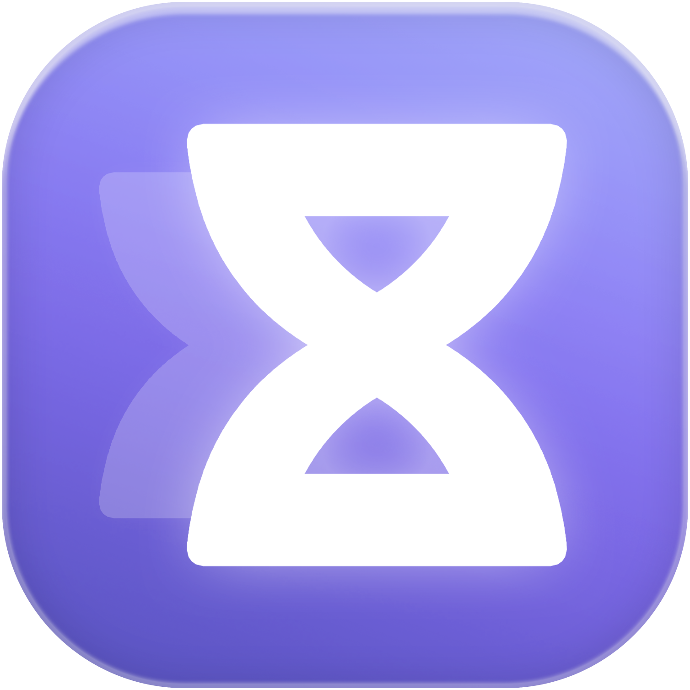
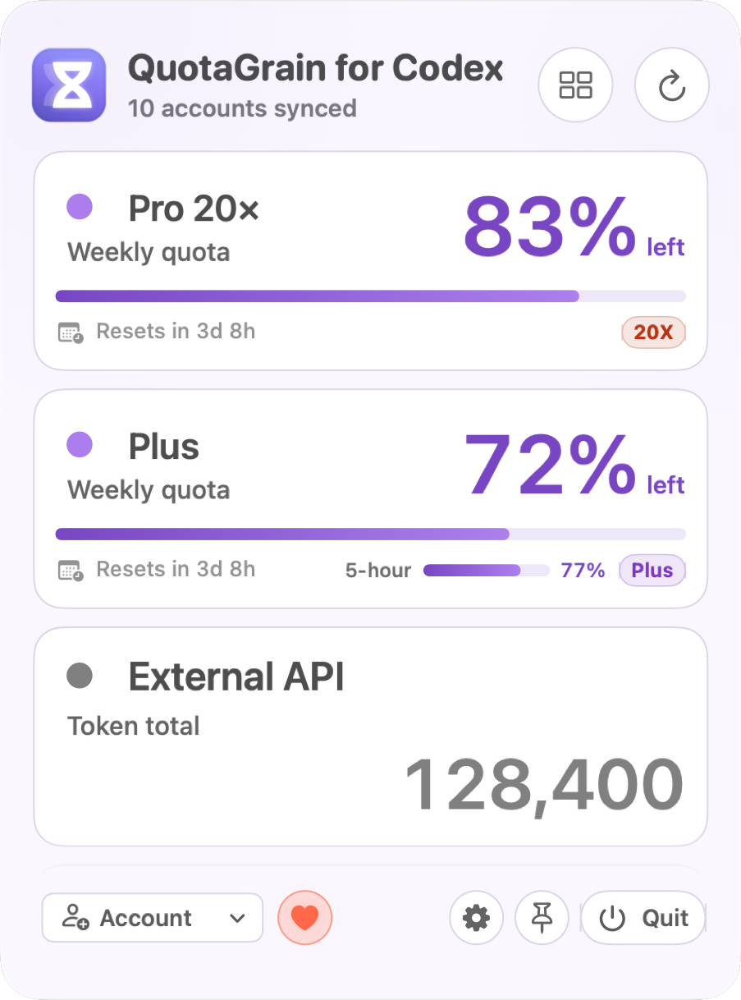
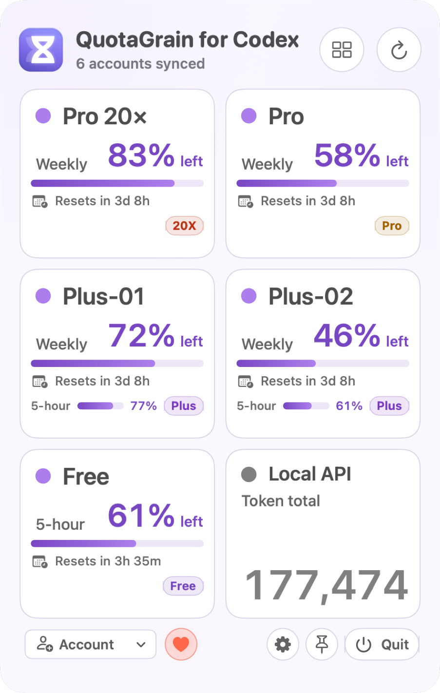

<h1 align="center">QuotaGrain for Codex</h1>

<a href="README.md">English</a> · 中文

QuotaGrain for Codex 是一款 Mac 菜单栏工具。它把多个 Codex 账号的剩余额度和重置时间放在同一个面板里，也可以从账号卡片打开各自独立的桌面客户端。

**1.0.3 版继续提供免费下载，最多可管理 2 个账号，不限时。**

<strong><a href="https://github.com/seanye73/QuotaGrain-for-Codex/releases/latest/download/QuotaGrain-for-Codex-arm64.dmg">免费下载 Mac 版（DMG）</a></strong> · Apple Silicon · macOS 13 或更高版本 <a href="https://seanye73.github.io/QuotaGrain-for-Codex/zh/">官网</a> · <a href="CHANGELOG.md">版本记录</a>

## 功能

  

- **额度一眼看清**：集中查看剩余额度、重置时间和账号异常。
- **多个客户端并行**：添加、命名、排序账号，从卡片打开各自独立的 Codex 客户端，配置和会话数据分别保存。
- **外部 API 与本地模型**：配置服务地址和模型，查看本地累计 Token。服务需兼容 OpenAI Responses；统计不代表服务商余额、剩余额度或账单。
- **自动刷新与提醒**：自动更新额度，按需开启低额度提醒，也可手动刷新。
- **适合你的界面**：单栏、双栏布局，浅色、深色或跟随系统；首次默认跟随系统语言，也可选择中文或英文。

## 双栏查看多个账号

  

## 安装

需要 **Apple Silicon Mac、macOS 13 或更高版本**，登录账号和打开客户端需要安装 Codex。

1. 从 [GitHub Releases](https://github.com/seanye73/QuotaGrain-for-Codex/releases/latest) 下载 DMG。
2. 打开安装包，将 **QuotaGrain for Codex** 拖进 **Applications（应用程序）**。
3. 从应用程序打开，再推出安装磁盘。

安装包已使用 Developer ID 签名，并通过 Apple 公证和 Gatekeeper 验证。可在 App 中“检查更新”，发现新版后前往 GitHub 下载并手动安装。

QuotaGrain for Codex 依赖 Codex 与 macOS 的现有机制。上游变更或限制可能导致部分功能不可用；后续版本与系统兼容性以实际发行情况为准。

## 使用

添加账号 → 登录或配置外部 API → 查看额度或 Token → 从账号卡片打开 Codex。

QuotaGrain for Codex 使用独立的 App、进程与菜单栏图标。多个客户端可并行运行，各自保留配置、认证信息与会话数据。

## 隐私

账号登记、设置、额度快照和 Token 汇总保存在本机。通过软件新建的账号保存在 `~/.codex/accounts/` 下各自的目录，客户端数据保存在该目录的 `desktop/` 子目录。原有 `~/.codex` 默认账号数据保持原样。

额度查询以只读请求访问 ChatGPT；外部 API 的模型发现和连接检查访问你指定的服务商，必要的连接测试可能产生服务商费用。账号凭据不发送给作者，也不写入用量日志。详见[隐私说明](SECURITY.md)。

## 账号与激活

已有激活码的用户可在 App 的支持页粘贴原码，点击「验证并解锁」。[既有订单与退款说明](TERMS.md#退款与订单协助)

## 反馈

有问题？[联系作者](mailto:x73.sean.ye@outlook.com)。

QuotaGrain for Codex 是独立开发的第三方工具。相关产品名称的商标归各自权利人所有。
